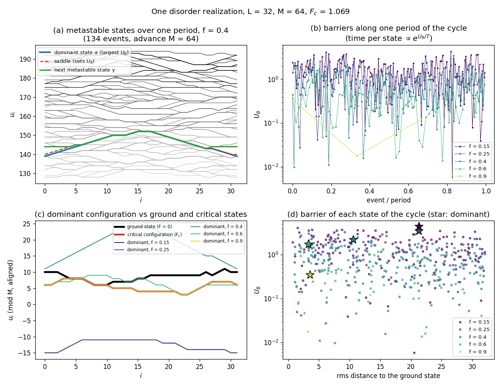
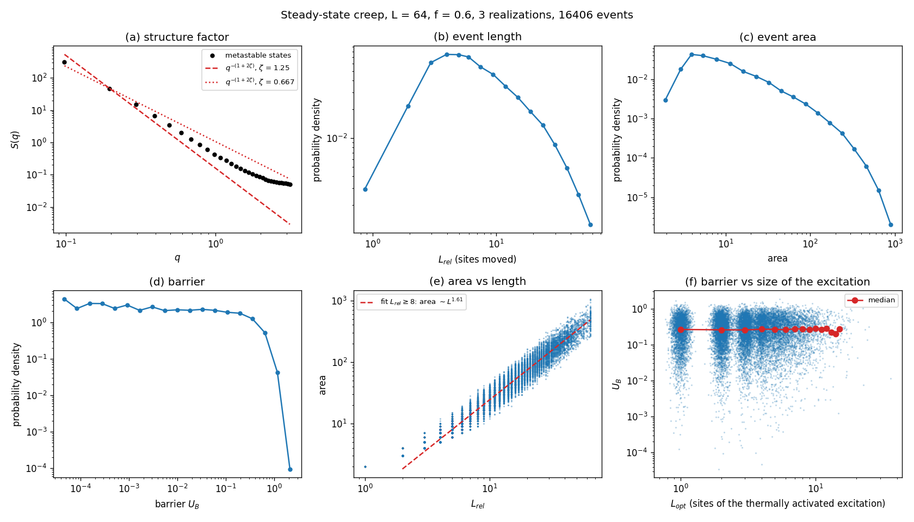

# krgk-creep

Creep dynamics of a directed elastic line in a random potential in the limit T → 0⁺, with the exact transition-pathway algorithm of Kolton, Rosso, Giamarchi and Krauth (KRGK) [1, 2]:

- the line goes from one metastable state to the next lower one through the path of minimal energy barrier;
- each step is a thermally activated event: an optimal excitation of size L_opt followed by a deterministic relaxation (avalanche) of size L_rel.

This repository keeps the original code and a clean, faster reimplementation of its creep driver for a directed line (a domain wall in a thin film), with a regression test between the two. It reaches deep creep (H ≪ H_d), where Langevin dynamics is too slow.

## Contents

| path | |
|---|---|
| `src/krgk_creep.cpp` | clean implementation of the KRGK creep dynamics for a periodic directed line (C++17, no dependencies) |
| `tests/regression.sh` | compares `krgk_creep` with the original code on the same disorder |
| `original/vmc/` | the original code (C++, Blitz++, serial), from `cuerdas_elasticas/vmc` (bitbucket `abk_balde/cuerdas_elasticas`, last change 2019), unmodified |
| `original/common/` | helpers of that repository (the large safe-prime tables were left out) |
| `demo/` | demo runs and figures (`demo/run_demo.sh`, `demo/plot_demo.py`, `demo/figures/`) |
| `original/patches/vmc-return.patch` | the one-line fix the original needs to run when compiled with optimisation (see [Review](#review-of-the-original-code)) |

## Build and run

```
make                         # build/krgk_creep
make test                    # regression against the original (needs Blitz++ and FFTW3)
build/krgk_creep --L 64 --M 256 --f 0.3 --events 1000 --out run1
```

Options (`build/krgk_creep --help`):

| option | meaning | default |
|---|---|---|
| `--L` | line length (sites, periodic) | 16 |
| `--M` | period of the disorder along u | 64 |
| `--mcut` | maximal slope \|u_{i+1} − u_i\| | 1 |
| `--disorder` | strength of the Gaussian disorder (std) | 1.0 |
| `--c` | elastic constant | 2.0 |
| `--f` | drive F/F_c (F with `--absolute`) | 0.08 |
| `--seed` | random seed | 12345 |
| `--events` | number of creep steps | 100 |
| `--advance` | stop earlier, once the mean position has advanced by this much | 0 (off) |
| `--limit` | search envelope u ≤ α + limit·M | 5 |
| `--conf-every` | write the metastable state every n steps to `configs.bin` (int32, L per record) | 0 (never) |
| `--save-events` | write α, saddle, β and γ of every step to `events.bin` | off |
| `--ground` | compute the ground state at F = 0 (`ground_state.dat`) | off |
| `--out` | output directory | `.` |

Outputs:
- `params.txt`: the parameters, F_c and F.
- `events.dat`: one line per creep step, with columns
  - `step`;
  - `barrier`: U_B, the minimal barrier;
  - `L_opt`: sites moved in the last excited configuration before the final relaxation;
  - `L_rel`: sites moved from α to the new metastable state γ;
  - `area`: Σ(γ − α);
  - `mean_u`;
  - `E`: energy of γ;
  - `expanded`: configurations expanded by the search.
- `critical.dat`: the critical configuration, the one that blocks the line at the last raise of F when locating F_c (one u_i per line).
- `ground_state.dat` (with `--ground`): the ground state at F = 0, by transfer matrix over u_0 ∈ [0, M) and u_i − u_0 ∈ [−L·mcut/2, L·mcut/2], with u_L = u_0. Cost O(M·L²·mcut²).
- `events.bin` (with `--save-events`): for each step, four int32 records of L values:
  - α, the metastable state before the step;
  - the saddle, the configuration with the highest energy taken from the queue, which sets U_B;
  - β, the last configuration taken from the queue, before its relaxation;
  - γ, the new metastable state.

## Demo

`demo/run_demo.sh` runs the examples below (about 15 minutes with 3 parallel jobs) and `demo/plot_demo.py` makes the figures.

### One disorder realization

L = 32, disorder periodic in u with M = 64, seed 7, f = F/F_c = 0.15 to 0.9. Each run continues until the line has advanced by 3M.

Because the disorder is periodic, the steady state is a periodic cycle of metastable states: γ_{n+P} = γ_n + M. At T → 0⁺ the time spent in a state grows as exp(U_B/T). The cycle is therefore dominated by the state with the largest barrier, the **dominant configuration**.



- (a) The metastable states of one period at f = 0.4, and the event that leaves the dominant state (α, saddle, γ).
- (b) The barriers along one period.
- (c) The dominant configuration at each f, the ground state at F = 0, and the critical configuration at F_c. Configurations are shifted by multiples of M to the nearest copy of the ground state.
- (d) The barrier of every state of the cycle against its rms distance to the ground state.

For this sample:

| f | period (events) | dominant U_B | rms distance to ground state | rms distance to critical |
|---|---|---|---|---|
| 0.15 | 144 | 4.35 | 21.3 | 18.4 |
| 0.25 | 155 | 3.44 | 21.3 | 18.4 |
| 0.4 | 134 | 2.19 | 10.6 | 13.4 |
| 0.6 | 58 | 1.73 | 3.3 | 1.9 |
| 0.9 | 3 | 0.34 | 3.5 | 0.0 |

- Near F_c the dominant configuration is the critical one.
- At f = 0.15 and 0.25 the dominant state lies in another valley. The state of the cycle closest to the ground state (rms distance 1.5) has the second largest barrier at f = 0.15 (4.11, against 4.35). Reaching the f → 0 limit, where the dominant state should approach the ground state, needs lower f, and the cost of the search grows quickly as f decreases.

### Steady-state statistics

L = 64, f = 0.6, three realizations, M = 16384 so that the disorder never repeats (the advance is 6000). The first advance of 1000 is discarded; 16 406 events remain.



- (a) Structure factor of the metastable states.
- (b–d) Distributions of L_rel, area and U_B.
- (e) Area against L_rel.
- (f) U_B against L_opt.

At this drive the excitations are small (L_opt mostly 1–10 sites) and their barrier hardly depends on L_opt. The asymptotic creep regime needs L_opt ≫ 1, that is lower f and larger L. Lazy children (below) are the first step to make that affordable.

## Model and algorithm

Energy of the line u_i (integer, i = 0..L−1, periodic):

E = Σ_i [ V(i, u_i mod M) − F u_i + (c/2)(u_{i+1} − u_i)² ],  with |u_{i+1} − u_i| ≤ mcut.

The disorder is Gaussian and uncorrelated, with zero mean and strength `--disorder`. It is periodic in u with period M.

**Elementary moves.** A block of consecutive sites (from one site to the whole line) is displaced rigidly by ±1. The move is allowed if the two border slopes stay within mcut.

**Critical force.** F_c follows the procedure of the original:
1. relax backward;
2. advance the line by 2M with forward moves, raising F by the smallest energy cost per site whenever no forward move lowers the energy.

**Creep step from a metastable state α (flooding).**
1. Expand configurations in increasing order of energy. Each one taken from the queue is first relaxed forward to its metastable state ("mother"); then all of its forward elementary moves ("children") are inserted in the queue.
2. Stop at the first mother with E < E(α); that is γ.
3. The barrier is U_B = max(E) − E(α) over the configurations taken from the queue. Because they leave the queue in order of energy, this is the minimal barrier among the forward paths [2].

The search is restricted to u ≤ α + limit·M.

## Review of the original code

Found while porting it (2026-10-17). The bugs are fixed in `src/krgk_creep.cpp`, which gives the same F_c and the same events as the patched original (`make test`).

**Bugs**

1. `vmc.cpp:9–12`: `Real VMC(int idir)` calls `VMC(idir, 0.0, 0.0)` without `return`. That is undefined behaviour.
   - `find_critical` uses this value. The Makefile compiles without `-O` (its `-O3` is only on the link line), and at `-O0` the value happens to survive in the return register.
   - With `-O2` the program crashes (segmentation fault) inside `find_critical`.
   - `original/patches/vmc-return.patch` fixes it; with the fix, `-O2` gives the same events as `-O0`.
2. `vmc.hpp`, `vmc.cpp:201, 240`: slopes are stored in `bitset<2>` (values 0–3), but the overflow check accepts up to 9.
   - With mcut ≥ 2 the stored slopes are silently truncated and the reconstructed configurations are wrong.
   - `adjust_mcut()` can raise mcut above 1.
3. `actions.cpp:230`: with `INSTANTONIC_WALK`, which the Makefile defines, `idist_stop` is compared without being initialised (`idist == idist_stop`). It works because the garbage is compared with itself.
4. `mainalbe.cpp`, creep driver:
   - `int im1 = (i-1) % P.Ihmax` is −1 for i = 0, which reads `Is_meta(-1)` out of bounds;
   - `zlow` and `zhigh` are uninitialised when no site of the event satisfies their condition.
5. `mainalbe.cpp`: the periodicity of the steady state is detected by comparing the mean position, `mean(Is_meta) == cm + M`, in floating point and not the whole configuration. Two different states with the same mean would be taken as periodic images.
6. `mainalbe.cpp:1040–1047`: two `int` functions without `return`.
7. `-c` ("creep" in the help) sets `creep_flag`, which `main` never reads. The creep driver is `-o`.
8. `Energy_conf` and `Energy_elastic` ignore the tilt `shift` in the periodic bond, while `Energy()` includes it. These are diagnostics only.
9. `OPTIMIZE5`: the tables `IM_table` and `Ih_table` stop the program once the line has advanced by more than 8·M·mcut.

**Performance**

1. **No closed set.** A configuration taken from the queue can be generated again by another mother and expanded again. In the regression case (L = 16) one event took 399 293 expansions for 1 237 distinct configurations, about 240 times the necessary work.
   - The energy of a configuration does not depend on the path that reached it, so skipping configurations already expanded does not change the result.
   - `krgk_creep` keeps a hash set of expanded configurations and is ~55 times faster on the regression case: 22 events in 1.1 s against 60 s.
2. Each key stores a `vector<bitset<2>>`, which takes 8 bytes per slope (`sizeof(bitset<2>) == 8`). The 2-bit slopes are thus stored in 64 bits each. `krgk_creep` packs them into ⌈log₂(2·mcut+1)⌉ bits.
3. The barrier search printed several lines per expansion (867 000 lines in one minute at L = 16).

## Suggested improvements (not done yet)

1. **Lazy children.** Store (E, mother, block move) in the queue instead of the full child configuration, and build the child only when it is taken. The queue holds ~L² children per expansion; at L = 64 the memory (186 MB for 20 events) is the limit, not the time.
2. **Upper bound on the barrier.** Find a cheap first path, for example with the approximate searches of `find_Besc2`, and use its barrier to prune children with E − E(α) above it. This is the role of the unused `Wmax` argument of the original.
3. **Faster forward relaxation.** Each move scans all O(L²) blocks from the shortest. By no-passing, the forward relaxation ends in the same metastable state whatever the order of the moves. That holds for single-site moves, and should be checked for block moves before relying on it. Local updates and a list of unstable sites would then make it O(L) per move.
4. **Non-periodic disorder in u.** With period M, after the line advances by M the sequence of events repeats exactly. Long runs need M much larger than the total advance, or disorder generated on demand, for example a hash of (i, j) with a counter-based generator.
5. **Correlated disorder.** To set the correlation length ξ independently of the lattice.

## References

1. A. B. Kolton, A. Rosso, T. Giamarchi and W. Krauth, *Dynamics below the depinning threshold in disordered elastic systems*, Phys. Rev. Lett. **97**, 057001 (2006). doi:10.1103/PhysRevLett.97.057001
2. A. B. Kolton, A. Rosso, T. Giamarchi and W. Krauth, *Creep dynamics of elastic manifolds via exact transition pathways*, Phys. Rev. B **79**, 184207 (2009). doi:10.1103/PhysRevB.79.184207
3. E. E. Ferrero, L. Foini, T. Giamarchi, A. B. Kolton and A. Rosso, *Spatiotemporal patterns in ultraslow domain wall creep dynamics*, Phys. Rev. Lett. **118**, 147208 (2017). doi:10.1103/PhysRevLett.118.147208

If you use this code, please cite [1] and [2].
